# Viva Foundation system architecture

Viva is Vivacity's robotics firmware, development and deployment platform. Version
0.1.0 is an initial engineering foundation, not production-ready robot control.

Outcome: establish the same inspectable controller behavior on ESP32-S3 and
STM32 NUCLEO-G491RE, with independently compilable portable C and real evidence.

Scope: controller lifecycle, diagnostics, configuration, capabilities, development
serial protocol, RTOS adapters, build/flash tools, and validation. External motors,
actuators, perception, planning, fleet management, and Studio are outside v0.1.

```mermaid
flowchart TD
    H[Host validation client] <-->|115200 8N1; protocol v1| HAL[Platform console HAL]
    HAL <--> R[Single controller runtime task]
    R --> C[Portable C core and protocol]
    R --> O[OS abstraction interface]
    O --> F[ESP-IDF FreeRTOS adapter]
    O --> Z[Zephyr adapter]
    F --> E[ESP32-S3]
    Z --> S[NUCLEO-G491RE]
    T[Same portable self-tests] --> C
    R --> T
```

The native build links exactly the same `viva_core.c`, `viva_protocol.c`, and
`viva_selftest.c` used by both board builds. It does not include any RTOS header.
The runtime owns its core context and serial parser; no core state is shared with
other tasks. External callers must serialize access to a context.

Memory is statically bounded in Viva code: no malloc/free, 128-byte requests,
512-byte responses, an eight-element uint32 queue, and static RTOS test tasks.
Frameworks retain their own internal allocation policies. This is not a claim
that either complete RTOS image is heap-free.

Trust boundary: the local serial console is unauthenticated development access.
It can modify the telemetry period and inject/recover diagnostic faults. Never
expose it to an untrusted network or connect actuators. No networking, OTA,
credential storage, remote execution, or actuator drivers are implemented.

The host tools record source fingerprints, binary hashes, timestamps, USB
identity, raw logs, and individual checks. Host tests cannot create hardware PASS
evidence. Profiles distinguish implementation/configuration from physical
verification. The release gate rejects missing or stale source evidence.

One authoritative Viva checkout remains at `P:\VIVACITY\viva-foundation`.
Ubuntu 24.04 WSL2 resolves it to `/mnt/p/VIVACITY/viva-foundation`; toolchain
dependency checkouts live at `/opt/viva-toolchains`, not a second Viva repository.

Long-term boundaries: Firmware/HAL form this milestone. Host Runtime, SDK,
Studio, Intelligence, Simulation and Deployment services remain roadmap work.

Evidence and assumptions: source architecture and native behavior are testable
locally. USB UART routing and power configuration must be verified per physical
board. See the physical report for actual results rather than inferring them from
this architecture.
