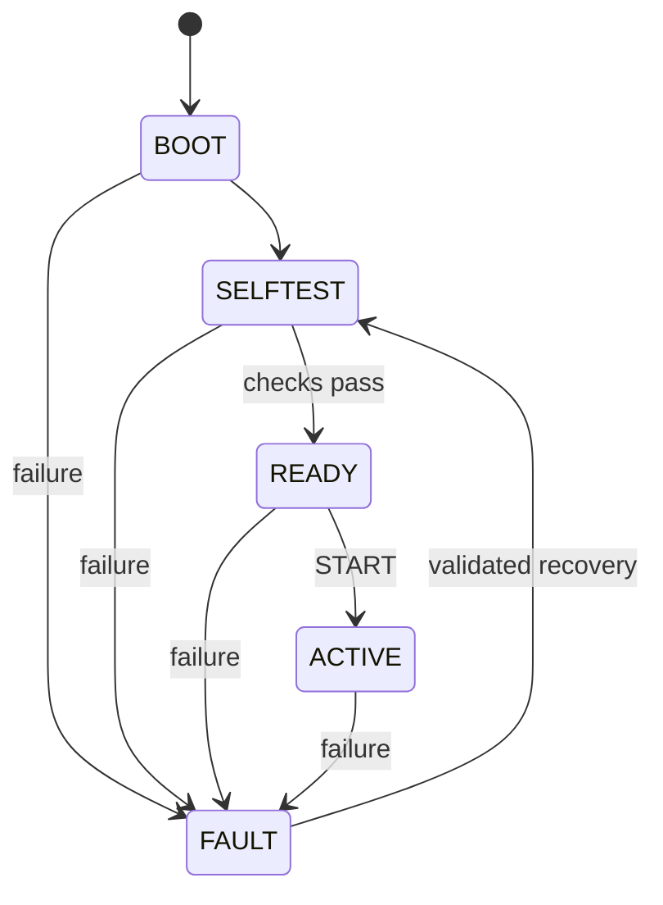

# Firmware API and execution model

Public portable interfaces are `firmware/core/include/viva_core.h` and
`viva_protocol.h`. C11 is required. The caller owns a zero-initialized context;
call `viva_init` before any state-changing API. The platform identifier must be a
nonempty constant string (maximum 32 lowercase letters/digits/underscore/hyphen)
whose lifetime exceeds the context. A successful initialization replaces the
context; invalid configuration leaves it unchanged.

| API | Contract |
| --- | --- |
| `viva_init` | Validate config/capabilities, establish BOOT, store monotonic epoch |
| `viva_begin_selftest` | BOOT to SELFTEST only |
| `viva_finish_selftest` | SELFTEST to READY if all checks passed, otherwise FAULT |
| `viva_activate` | READY to ACTIVE; no physical outputs exist |
| `viva_tick` / `viva_uptime` | uint64 milliseconds; backward clock triggers FAULT |
| `viva_health` | BOOTING, READY, OK for ACTIVE, or FAULT |
| `viva_config_validate` | Schema v1, telemetry 100–5000 ms, watchdog at least twice telemetry and at most 60000 ms, valid capability subset |
| `viva_configure` | READY only; atomically update telemetry period; watchdog/capability changes require rebuilding/rebooting |
| `viva_fault` | Explicit nonzero known code, sticky history, saturating fault counter |
| `viva_recover` | FAULT only; fresh checks and valid configuration required; returns via SELFTEST to READY |
| `viva_platform` / `viva_version` | Stable identity and semantic firmware version |

Public diagnostics include last fault, fault/recovery counts, and invalid request
counts. Historical last fault remains after recovery. Invalid host requests return
an error and increment diagnostics; ordinary malformed input does not crash or
fault the controller. Transport IO errors and backward clocks fault it.

Error numbers: 0 OK, 1 argument, 2 configuration, 3 lifecycle, 4 capability,
5 overflow, 6 protocol, 7 protocol version, 8 clock, 9 self-test, 10 IO,
11 timeout, 12 unsupported. `viva_fault` returns the recorded error code.

The common runtime initializes the console, enters BOOT/SELFTEST, executes 18
portable assertions in an isolated context, runs the OSAL smoke test, installs the
watchdog, and enters READY only if checks pass. It polls input in bounded batches,
emits telemetry periodically, and feeds its watchdog every loop. ACTIVE is a
logical lifecycle state only. No actuator code is present.

OSAL interfaces cover monotonic timing, sleep, static task start/join, mutexes,
eight-element queues, critical sections, and watchdog start/feed. Object storage
is deliberately backend-specific: FreeRTOS uses static native control blocks and
ESP-IDF task stacks; Zephyr uses k_thread/k_msgq/k_mutex and kernel stack macros.
Do not copy initialized OS objects, reuse running task storage, nest critical
sections, or call blocking OSAL APIs from interrupts. Timeout values are bounded
application values in milliseconds, not an infinite-wait sentinel. Queues carry
uint32 values by copy; no pointer ownership crosses a queue.

The RTOS self-test checks task execution/join, a queue round trip and empty queue
timeout, mutex lock/unlock, critical section entry/exit, and increasing time.
Recovery reruns the isolated core tests and checks console/watchdog availability;
it does not repair broken hardware or reconfigure watchdog hardware.

ESP-IDF uses `esp_timer_get_time`, static FreeRTOS objects, and task watchdog
subscription to the controller task. Zephyr uses k_uptime_get and the STM32 IWDG
driver with reset-on-expiry. Physical reports specify whether only start/feed or
also deliberate starvation was tested. A watchdog reset reboots through self-test
and clears volatile fault history. No fault persistence is implemented.

STM32 UART reception is interrupt-driven into a static 256-byte ring buffer;
ESP-IDF uses its driver's 512-byte receive buffer. The runtime polls these buffers,
not unbuffered hardware registers. Overflow faults and resynchronizes at newline;
there is no flow-control guarantee for a continuously flooding host.

Firmware version is 0.1.0, config schema 1, protocol 1. The build ID is a normalized
SHA256 fingerprint of firmware source/configuration, root build definitions,
version and pinned toolchain/build scripts (`src-` plus 16 hex digits),
generated before CMake configuration. Binary hashes bind test results to artifacts.
